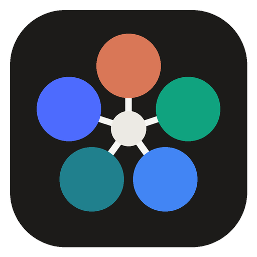

<p align="center"></p>

# Ensemble

**Claude, ChatGPT, Gemini, Perplexity and DeepSeek working together on your projects.**

Ensemble is a small Windows app that turns five AIs into one team. Claude, ChatGPT and Gemini run on the memberships you already pay for; Perplexity and DeepSeek run on cheap pay-as-you-go API keys.

- **Council** – every model answers your question, reads the others' answers and revises, then one merges the best into a final answer. For writing, research, decisions and second opinions.
- **Build** – Perplexity researches current docs on the web, one model plans, another writes the code, a third reviews it, and fixes loop until the reviewer approves. Work lands on a new git branch so your main branch is never touched.

It's a single program, one download. **No Node.js, Python, Tailscale or other runtime needed.** It opens in its own window using Windows' built-in WebView2 (already on Windows 10 and 11), and it can install the AI tools for you.

## Install

1. Download `Ensemble-windows-amd64.zip` from the [latest release](../../releases/latest) (or `arm64` for Snapdragon/ARM laptops) and unzip it anywhere, e.g. `C:\Users\you\Apps\Ensemble`.
2. Double-click **Ensemble.exe**. (Windows SmartScreen may warn about an unrecognized app the first time: click *More info → Run anyway*.)
3. Click any red chip at the top, then **Install for me** and **Open sign-in window**. Ensemble runs that company's official installer and opens its sign-in for you. Click a yellow chip to add an API key.

For **Build**, you also need git; the Build tab offers **Install git** if it's missing.

## Use it from your phone

Your phone becomes a remote for your PC: the AIs still run on the PC (that's where your memberships are signed in), and from your phone you start councils and builds, watch them live, and read the results, from anywhere.

It goes over [Tailscale](https://tailscale.com), a free private network between your own devices. Nothing is opened to the internet. **Tailscale is built into Ensemble**, so the PC needs nothing extra; the phone needs the free Tailscale app (that's what lets it into your private network).

1. In Ensemble on the PC, click **Phone** → **Turn on** → **Sign in to Tailscale** (free; Google, Microsoft, Apple or GitHub accounts work). Ensemble appears in your Tailscale account as a device called `ensemble`.
2. On your Android phone, install the **Tailscale** app from the Play Store and sign in with the same account.
3. Scan the QR code in Ensemble with your phone's camera, then in Chrome's ⋮ menu tap **Add to Home screen** → **Install**. Ensemble now opens full-screen from its own icon.

For the full-screen app, your Tailscale account needs **HTTPS Certificates** turned on (one switch in the Tailscale admin console; Ensemble shows a button for it). Until then, phone access works over plain HTTP inside Tailscale and the phone can only add a browser shortcut; Ensemble switches to HTTPS on its own once you flip the switch.

Good to know:
- Ensemble must be open on the PC (minimized is fine) and the PC awake. Phone access turns itself back on whenever Ensemble starts.
- The QR code carries a private pairing key. **Unpair phones** in the same panel makes a new one; **Sign out** disconnects Ensemble from Tailscale.
- If you already use the Tailscale app on your PC, that's fine: Ensemble is its own separate device in your account.
- From the phone you type the project folder path (or pick a recent one); the PC's folder picker and pairing settings stay PC-only.
- Runs started on either device show up on both, and live progress picks up where it left off when your phone wakes.

## How it uses your memberships (and why it's safe)

Consumer plans like ChatGPT Plus, Claude Pro and Google AI Pro don't come with API keys, and scripting their websites breaks their terms and can get accounts flagged. Instead, each company ships an official command-line app that you sign into with your plan. Ensemble only **launches those official apps and reads what they print**. It never touches their login tokens, never automates a website, and never sends your data anywhere else. None of them need Node.js either:

| Membership | Official app Ensemble drives | Install (PowerShell) | Sign in |
|---|---|---|---|
| Claude Pro / Max | Claude Code (`claude`) | `irm https://claude.ai/install.ps1 \| iex` | run `claude` once |
| ChatGPT Plus / Pro | Codex CLI (`codex`) | `irm https://chatgpt.com/codex/install.ps1 \| iex` | `codex login` → *Sign in with ChatGPT* |
| Google AI Pro / Ultra | Antigravity CLI (`agy`) | `irm https://antigravity.google/cli/install.ps1 \| iex` | run `agy` once |

Notes, as of October 2026:
- Google moved AI Pro/Ultra sign-ins from Gemini CLI to the Antigravity CLI in June 2026, which is why Ensemble uses `agy`.
- Anthropic counts `claude -p` use toward your Claude plan's normal usage limits, shared with the Claude app.
- Codex with ChatGPT sign-in draws on your ChatGPT plan's included Codex usage.
- Ensemble re-reads your PATH from Windows on start, so tools you just installed are found without signing out.

### Perplexity and DeepSeek (API keys)

Neither of these has a membership that outside apps can use, so they need an API key with some prepaid credit:

| AI | Why a key | What it does in Ensemble | Rough cost | Get a key |
|---|---|---|---|---|
| Perplexity | Pro/Max plans don't include API use | Web research with sources: the Research step in Build, and a council member | ~5–10¢ per request (`low` preset) | perplexity.ai/account/api |
| DeepSeek | There is no DeepSeek membership; chat is free, the API is pay-as-you-go | A full agent that can plan, build, review and fix, by running Claude Code on DeepSeek's models (DeepSeek's own documented setup) | a fraction of a cent to a few cents per step | platform.deepseek.com |

Add keys by clicking the yellow chip in the app, or with `ensemble-cli key perplexity <key>`. Keys go in `%USERPROFILE%\.ensemble\keys.json` or can come from `PERPLEXITY_API_KEY` / `DEEPSEEK_API_KEY`. They are only sent to that vendor, never into prompts or logs.

DeepSeek runs inside Claude Code with its **own settings folder**, so it never uses or changes your Claude login. It needs Claude Code installed. To use DeepSeek V4-Pro instead of Flash, set `"agents": { "deepseek": { "env": { "ANTHROPIC_MODEL": "deepseek-v4-pro" } } }` in your config.

Perplexity can't see your project files, so it's only used for research and council answers, never planning, building or reviewing.

Every run uses up some of each plan's limits (or key credit). If a model hits its limit, runs out of credit, isn't signed in, or isn't installed, Ensemble skips it, says so, and hands the step to the next model.

## What each model is allowed to do

| Mode | Claude | Codex | Gemini (agy) | DeepSeek | Perplexity |
|---|---|---|---|---|---|
| Answer / plan / review | read files only | read-only sandbox | approvals off, so it can only read | read files only | web only, no files |
| Build / fix | auto-accepts **file edits only** (no shell) | `workspace-write` sandbox (project folder only) | **off by default** | file edits only (no shell) | never |

`agy` has no "edits only" mode; letting it build means skipping *all* its approvals, shell included. To allow it anyway, run `ensemble-cli config` and set `"agents": { "gemini": { "allowWrite": true } }`.

## Command line

`ensemble-cli.exe` (in the same zip) does everything from a terminal:

```powershell
ensemble-cli doctor
ensemble-cli council "Should Kept store shifts in SQLite or Supabase?"
ensemble-cli council "Tighten this cover letter" --file letter.md --rounds 1
ensemble-cli build C:\Projects\my-app "Add CSV export with a date-range filter, plus tests" --test "npm test"
ensemble-cli build .\site "Make the landing page mobile-friendly" --builder deepseek --reviewer codex
ensemble-cli key deepseek sk-...
ensemble-cli ui        # dashboard in your browser instead of the app window
```

Agent ids: `claude`, `codex`, `gemini`, `perplexity`, `deepseek`.
Options: `--agents a,b,c`, `--rounds N`, `--chair <id>`, `--researcher/--planner/--builder/--reviewer/--fixer <id>`, `--no-research`, `--test "<cmd>"`, `--allow-dirty`, `--no-branch`, `-v` to stream raw output.

## Where things go

- **Build runs:** your project gets a branch `ensemble/<task>-<id>` with one commit. Research, plan, reviews, diffs and every prompt/answer are in `<project>\.ensemble\` (kept out of git automatically). If the folder wasn't a git repo, Ensemble creates one with a baseline commit first. It refuses to start on uncommitted changes unless you allow it.
- **Council runs:** `%USERPROFILE%\.ensemble\council\<id>\` (`final.md` is the answer).
- **Config:** `%USERPROFILE%\.ensemble\config.json` – change default roles, timeouts, or a tool's flags if a vendor changes them.

## Security

The app's built-in server listens only on `127.0.0.1` on a random port, rejects requests addressed to any other host name, and requires a random per-launch token. Other websites open in your browser can't start runs. Programs Ensemble launches run hidden, without console windows.

Phone access (off until you turn it on) runs Tailscale's own networking library inside Ensemble and serves the phone app only on Ensemble's private Tailscale address, never on your normal network. It requires a long random pairing key, accepts only its own Tailscale name, and can't change pairing settings, install software, or open the PC's folder picker. Tailscale's state is kept in `%USERPROFILE%\.ensemble\tailscale`.

One-click installs run each company's official PowerShell installer (the same line shown under "Or install it yourself"), and git comes from winget, Windows' built-in package manager.

## Building from source

Needs [Go](https://go.dev/dl/) 1.27+ (`winget install GoLang.Go`).

```powershell
.\build.ps1          # → dist\Ensemble.exe and dist\ensemble-cli.exe
go test ./...
```

From macOS/Linux, `./build.sh` cross-compiles the Windows programs. Pushing a tag like `v0.3.0` makes GitHub Actions test on Windows and Linux and attach the zips to a release.

The tests use the test program itself as a fake AI and a fake Perplexity server to exercise council, research → build → review → fix, branch/commit handling, dirty-repo protection, cancelling, fallback when a plan runs out of usage or credit, key handling, config merging, the server's security checks, and phone pairing against a stand-in Tailscale device (sign-in link, HTTPS, HTTP fallback and automatic switch-over, unpairing, sign-out, resuming live progress).

`go build -tags notsnet` makes a build without the Tailscale library (no phone access), useful for offline development.

## License

MIT
